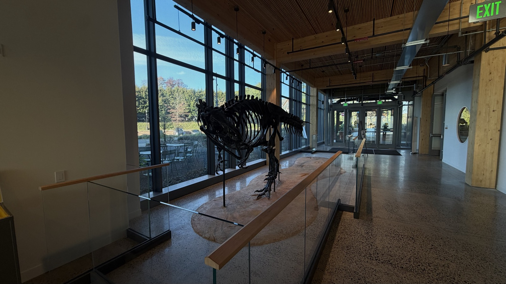

# Briger Hall Discovery Guide — Repository guide

Use this guide to create and publish your page. See the mini-project document for assignment requirements.

## 1. Make a new page

1. Open `station-template.html` and copy the complete file.
2. Return to the repository's main page and choose **Add file → Create new file**.
3. Name your file using lowercase letters and hyphens, ending in `.html`, for example `dinosaur-skeleton.html`. Keep it in the main repository folder, alongside `style.css`.
4. Paste the template.
5. Select **Commit changes**, enter a short message, and save to the branch used in class.

Edit your own page and media files. Leave the shared template, `style.css`, and other pairs' files unchanged.

## 2. Add and edit text

Open your HTML file and click the pencil icon to edit it. Replace the bracketed placeholders with your text, leaving the surrounding HTML tags in place. Change the title in both `<title>` (the browser tab) and `<h1>` (the page heading).

```html
<p>Your paragraph goes here.</p>
```

Use a separate `<p>...</p>` for each paragraph. Instructions inside `<!-- comments -->` do not appear on the published page. Keep the stylesheet link near the top of the file so the shared formatting works.

For a clickable link, replace the address and visible text:

```html
<a href="https://example.org">Link text</a>
```

The template's citation links, such as `href="#source-1"`, jump to an entry on the same page. Keep each link matched to the corresponding entry's `id="source-1"`.

## 3. Upload and add photos

1. Open the repository's `images` folder.
2. Choose **Add file → Upload files**, upload your image, and commit the upload.
3. In your HTML file, replace the example image path, alt text, and caption:

```html
<figure class="feature-image">
  
  <figcaption>Dinosaur skeleton in Briger Hall. Photo by [name].</figcaption>
</figure>
```

Use your own description and caption. **Alt text** describes the image for someone who cannot see it; **figcaption** is the caption displayed beneath it.

Use lowercase, hyphenated filenames, such as `dinosaur-skeleton.jpg`. Match the uploaded extension exactly: `.jpg`, `.jpeg`, and `.png` are different. To add another image, copy the whole `<figure>...</figure>` block and change its path, alt text, and caption.

## 4. Upload and add audio

Start with your downloaded MP3 file.

1. Name it to match your page, such as `dinosaur-skeleton.mp3`.
2. Open the repository's `audio` folder, choose **Add file → Upload files**, upload the MP3, and commit.
3. In your HTML file, replace **both** `audio/your-feature.mp3` paths: one in the audio player and one in the MP3 link.
4. Replace the audio caption and transcript placeholders.

The audio block should look like this, with your own filename and caption:

```html
<figure class="audio-guide">
  <figcaption id="audio-caption">Dinosaur skeleton — AI-narrated guide, 2:30.</figcaption>
  <audio controls preload="metadata"
         src="audio/dinosaur-skeleton.mp3"
         aria-describedby="audio-caption">
    Your browser does not support the audio player. Use the MP3 link below.
  </audio>
  <p><a href="audio/dinosaur-skeleton.mp3">Open the MP3 audio</a></p>
</figure>
```

Paste your transcript inside the template's `<div class="transcript-text">`, using `<p>...</p>` for paragraphs. Keep the surrounding `<details>` and `<summary>` tags; they create the expandable transcript panel.

If the `images` or `audio` folder is missing, ask your instructor to create it.

## 5. Publish and open your page

Commit your HTML edits and media uploads to the branch used for the site. If GitHub Pages is already configured for that branch, commits publish automatically; allow a few minutes for changes to appear.

For the standard GitHub Pages address for this repository, replace `your-file.html` with your filename:

`https://jms5151.github.io/ENV221_2026_Briger_Hall_Experience/your-file.html`

Use the site address provided by your instructor if it differs. The address beginning with `github.com` is for editing repository files; the published page uses the site's address.

To make later changes, open your file, click the pencil, edit, and commit again. Uploading a file with the same name and folder replaces the existing media without needing to change its HTML path.

## If something does not appear

- **Page missing:** Check the filename and published address. Your HTML file should be in the main repository folder.
- **Photo or audio missing:** Match the filename, capitalization, extension, and folder exactly. Use `images/filename.jpg` or `audio/filename.mp3`, not a path on your computer.
- **Formatting missing:** Keep your page beside `style.css` and retain `<link rel="stylesheet" href="style.css">` in the `<head>`.
- **Changes missing:** Make sure you committed them, wait a few minutes, and refresh the published page.
- **Layout broken:** Look for accidentally deleted tags or quotation marks. Compare the affected block with `station-template.html`.
